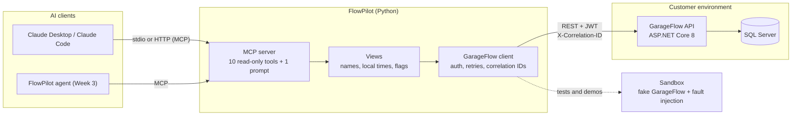

# FlowPilot

An AI support and integration copilot that gets **deployed into a customer's environment**. The
customer is an auto-service shop that runs [GarageFlow](https://github.com/Chandrabosechiluka/GarageFlow)
(my ASP.NET Core + SQL Server booking system). FlowPilot connects to it, exposes it to AI agents
through the **Model Context Protocol (MCP)**, and (from Week 3) investigates support tickets: it finds
the records involved, reads their history, works out the root cause and proposes a fix that a human
approves.

It is built the way a Forward Deployed Engineer works: integrate with a system you do not own,
handle its failures, respect its permissions, and leave the customer with something they can run.

> Status: **Week 1**: typed async client for GarageFlow's REST API (JWT sign-in and refresh, safe
> retries with backoff, correlation IDs, typed errors), a read-only MCP server with 10 task-shaped
> tools and a triage prompt, a fake GarageFlow sandbox with fault injection, and 44 tests that run
> in about a second.

## Architecture



| Folder | What it does |
|---|---|
| `src/flowpilot/garageflow/` | The integration layer. `client.py` talks to GarageFlow; `models.py` mirrors its C# contracts; `errors.py` turns ProblemDetails into typed exceptions. |
| `src/flowpilot/mcp_server/` | The MCP server. `server.py` defines the tools; `views.py` shapes their output for an LLM. |
| `src/flowpilot/sandbox/` | A fake GarageFlow with the same routes, JSON, roles and error bodies, plus switches to make it fail. |
| `tests/` | Client behaviour, every MCP tool, settings, and an opt-in contract test against the real GarageFlow. |
| `docs/` | Study notes and how-tos. |

## The tools

| Tool | Answers |
|---|---|
| `check_garageflow_health` | Is the API up, is the database reachable, can FlowPilot sign in? |
| `list_appointments` | What is booked on a day (or up to 14 days), with names and local times? |
| `get_appointment` | Everything about one appointment, including inspection results. |
| `get_appointment_history` | Who changed it, and when? |
| `find_customers` | Find a customer by name, email **or car registration number**. |
| `get_customer` | Contact details and vehicles. |
| `get_shop_catalog` | Services, who is qualified for each, technicians, bays. |
| `check_availability` | Free slots for a service on a day (does not book). |
| `list_waitlist` | Who is waiting, and which offers are outstanding. |
| `search_audit_log` | The shop-wide audit trail (needs an Admin account). |

Plus the prompt `triage_ticket`, which tells a model how to investigate a ticket with these tools.

Every record can carry **flags**: rule-based warnings written in code, such as "still Booked 3 hours
after its start time: the no-show background job may not be running". They are deterministic and
tested, so an agent can treat them as evidence rather than guesses.

## Design decisions

- **Read-only first.** All tools carry `readOnlyHint`. Write tools come in Week 3 behind human
  approval: an agent must not change a customer's bookings on its own.
- **Least privilege.** FlowPilot signs in as an Advisor. The audit-log tool is refused with a clear
  "needs Admin, do not retry" message instead of FlowPilot holding an Admin account by default.
- **Retry only what is safe to repeat.** GETs are retried on network errors, 429 and 502/503/504
  with exponential backoff, jitter and `Retry-After`. POSTs are never retried automatically, since
  GarageFlow has no idempotency keys and a retried booking could be booked twice. Health checks
  are not retried either: they must report what they see right now.
- **One correlation ID per call.** FlowPilot sends `X-Correlation-ID`; GarageFlow accepts it, so
  the same ID is in both systems' logs, and every error shown to the model includes it.
- **Errors a model can act on.** A GarageFlow failure becomes a tool error with what happened, the
  HTTP status, the correlation ID and what to do next. An unhandled exception would only show
  "Error executing tool".
- **Tolerant models.** Unknown JSON fields are ignored, so a GarageFlow upgrade that adds fields
  does not break FlowPilot.
- **Work around the customer's limits, and report them.** GarageFlow cannot search customers by
  registration number, which is how shop staff actually ask. FlowPilot scans the list (capped)
  and says so in a `note`, which doubles as product feedback.
- **A sandbox, plus a contract test.** Tests run against the fake GarageFlow in-process (no .NET,
  no SQL Server, no network). `tests/test_live_garageflow.py` checks the real API against the same
  models, so drift between the two is caught.

## Getting started (Windows, PowerShell)

Requires Python 3.12+ and [uv](https://docs.astral.sh/uv/) (`winget install astral-sh.uv`).

```powershell
cd F:\projects\FlowPilot
uv sync                      # creates .venv and installs everything from pyproject.toml
uv run pytest                # 44 tests, about a second

Copy-Item .env.example .env  # then edit it
```

**Option A: against the sandbox (no .NET needed).** In `.env` set `GARAGEFLOW_BASE_URL=http://localhost:5090`.

```powershell
uv run flowpilot-sandbox     # terminal 1: fake GarageFlow on http://localhost:5090
uv run flowpilot-mcp --http  # terminal 2: MCP server on http://127.0.0.1:8765/mcp
```

Then connect an AI client to it: see [docs/connect-to-claude.md](docs/connect-to-claude.md) for
Claude Desktop, Claude Code and the MCP Inspector.

**Option B: against the real GarageFlow.** Start GarageFlow in Development (see its README), keep
`GARAGEFLOW_BASE_URL=http://localhost:5080`, then check the contract:

```powershell
$env:GARAGEFLOW_LIVE="1"; uv run pytest tests/test_live_garageflow.py -v
```

Break the sandbox on purpose, to see retries and error messages:

```powershell
Invoke-RestMethod -Method Post http://localhost:5090/_sandbox/faults -ContentType application/json `
  -Body '{"fail_next": 2}'            # next 2 API calls answer 503 (FlowPilot retries and recovers)
Invoke-RestMethod -Method Post http://localhost:5090/_sandbox/faults -ContentType application/json `
  -Body '{"database_down": true}'     # /health/db answers 503
```

## Roadmap

| Week | Adds |
|---|---|
| 1 ✅ | GarageFlow client, read-only MCP server, sandbox, tests, CI |
| 2 | RAG over runbooks, past tickets and logs (PostgreSQL + pgvector); legacy-vendor connector and migration job |
| 3 | LangGraph triage agent (plan, act, observe), human approval for write actions, guardrails |
| 4 | Evaluation suite (tool-call accuracy, groundedness) gating CI; observability (cost, latency, errors) |
| 5 | Cloud deployment with a live demo, FDE documents (discovery, solution design, runbook, handoff), demo video |
